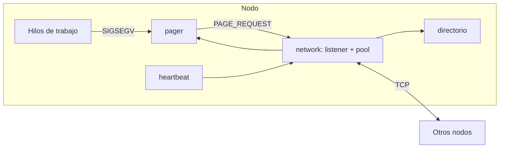
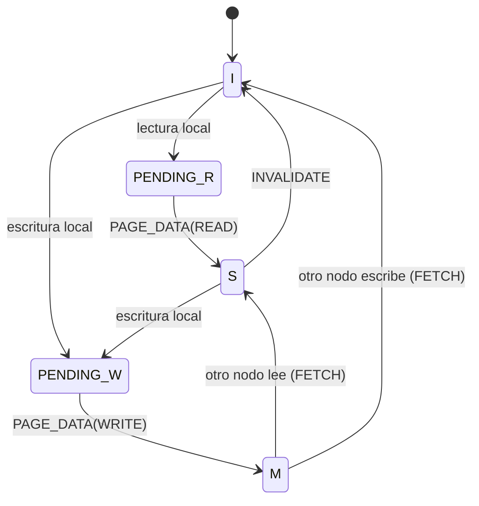
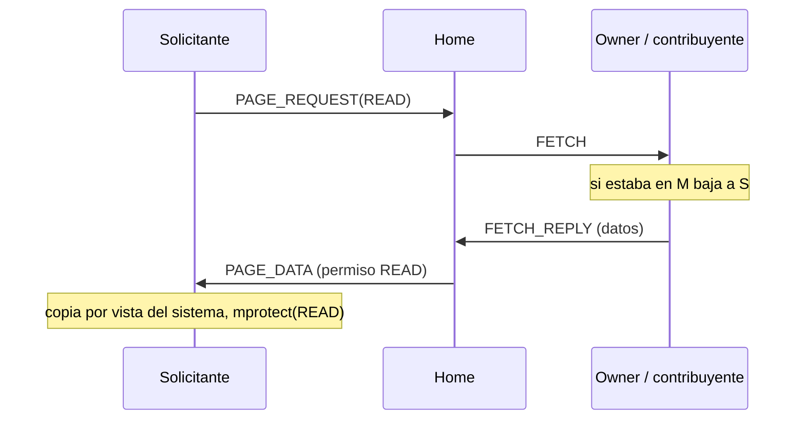
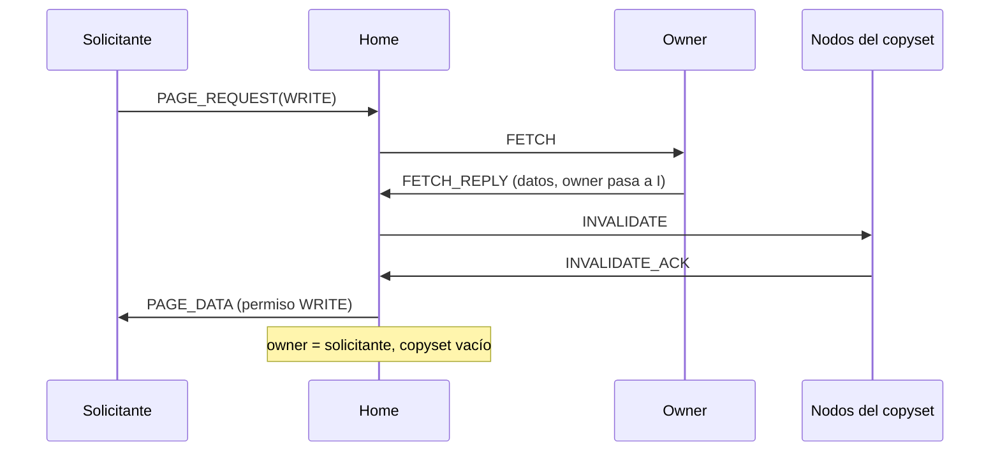
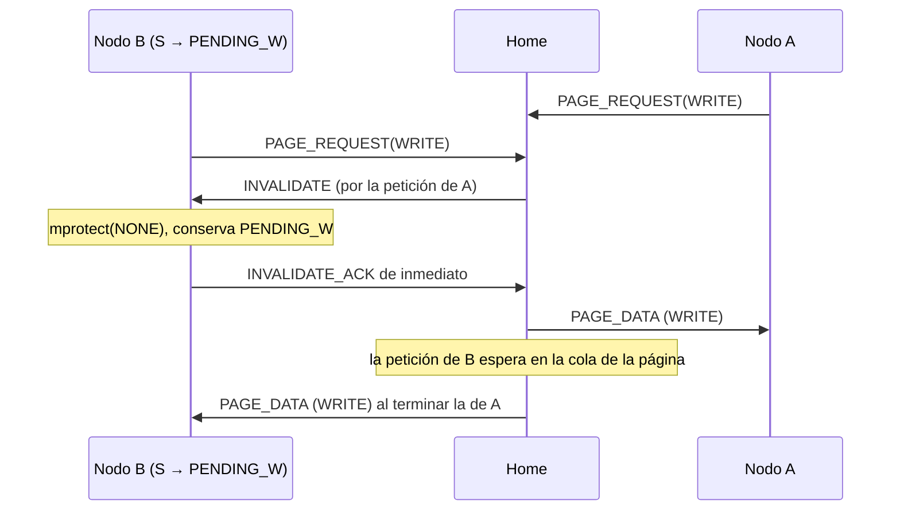

# Entregable 1: Diseño del sistema DSM con paginación bajo demanda y coherencia MSI

- **Curso:** IC-6600 Principios de Sistemas Operativos, II-2026
- **Autoras:** Ximena Molina y Susana Feng
- **Fecha de entrega:** 6 de noviembre de 2026
- **Lenguaje:** C 
- **Plataforma:** Linux x86-64

---

## 1. Descripción del sistema

Varios nodos (procesos DSM, identificados por IP y puerto) aportan cada uno un bloque de memoria. El sistema los presenta como **una sola memoria compartida**: la aplicación lee y escribe con punteros normales, sin saber en qué nodo están los datos.

Mecanismo:

1. Cada nodo reserva el espacio global con `mmap` en una dirección base común.
2. Las páginas que el nodo no tiene se marcan `PROT_NONE` con `mprotect`.
3. Si un hilo toca una de ellas, el kernel envía `SIGSEGV`.
4. El manejador (`sigaction` con `SA_SIGINFO`) lee `si_addr`, calcula el número de página, pide la página por TCP y espera.
5. Al llegar, se copia la página, se abre el permiso con `mprotect` y la instrucción fallida se reintenta de forma transparente.
6. El protocolo **MSI** garantiza que nadie lea datos viejos.

## 2. Decisiones de diseño

| # | Decisión | Estado | Resolución |
|---|---|---|---|
| D1 | Nodo *home* de cada página | Decidida | Hash de `page_id` (§3.2) |
| D2 | Espacio de direcciones al unirse un nodo | Decidida | Mapa fijo por *slots* en configuración, `max_nodes = 16` (§3.3) |
| D3 | Extra 1 (ejecución distribuida) | Indecisa | Dejar ganchos en protocolo y API (§12) |
| D4 | Extra 2 (tolerancia a fallas) | No se intentará | Documentar limitaciones (§11) |
| D5 | Doble mapeo | Decidida | `memfd_create` (§4.2) |
| D6 | Atención de peticiones en el hilo de red | Decidida | Listener + pool de hilos (§9.4) |
| D7 | Lenguaje | Decidida | C |
| D8 | Tamaño de página | Decidida | 4 KB por defecto, configurable |
| D9 | Ruta de `PAGE_DATA` | Decidida | Pasa por el home (§7.3) |
| D10 | Lectura vs. escritura en el handler | Decidida | Código de error en `ucontext` (x86-64), con respaldo por estado de página (§4.3) |
| D11 | Semántica de `dsm_barrier` | Decidida | Solo sincronización, sin write-back (§10) |
| D12 | Respuesta del owner al home | Decidida | Mensaje separado `FETCH_REPLY` (§7.3) |

## 3. Arquitectura general

### 3.1 Componentes por nodo

| Componente | Función |
|---|---|
| Hilos de trabajo | Ejecutan la aplicación; son los que reciben `SIGSEGV` |
| Hilo listener | Acepta conexiones TCP, lee mensajes y procesa las respuestas |
| Pool de hilos | Procesa peticiones que pueden bloquearse (§9.4) |
| Hilo de heartbeat | Envía y vigila latidos |
| Tabla de nodos | IP, puerto, memoria aportada, base, estado, último latido |
| Tabla de páginas local (`page_local_t`) | Estado MSI de cada página en este nodo |
| Directorio (`dir_entry_t`) | Solo para las páginas cuyo home (por hash) es este nodo |
| Tabla de procesos/asignaciones | Qué páginas pertenecen a qué proceso y en qué orden |



### 3.2 Asignación de home por hash (D1)

```
home(page_id) = slot_de( hash(page_id) mod max_nodes )
```

Todos los nodos usan la misma función hash y el mismo `max_nodes`. Se usa una mezcla simple (*splitmix64*) en lugar de `page_id % N` para que páginas consecutivas no caigan en el mismo home.

El home es **solo el gestor del directorio**, no necesariamente quien tiene los datos:

| Concepto | Qué es | Cómo se determina |
|---|---|---|
| Home (directorio) | Nodo que sabe estado, owner y copyset de la página | `hash(page_id)` |
| Owner inicial (datos) | Nodo que tiene los bytes al inicio | El nodo que aporta el rango donde cae la página |
| Owner actual | Nodo con la versión M, si existe | Se guarda en el directorio |

Costo: un salto de red más en algunos casos (pedir al home, que reenvía al owner). Se compensa con mejor reparto de la carga de coordinación.

### 3.3 Espacio de direcciones y unión de nodos (D2)

Si el home dependiera de la cantidad de nodos vivos, al unirse un nodo cambiaría el home de casi todas las páginas y habría que migrar el directorio. Para evitarlo:

- El archivo de configuración define `max_nodes` (16) y la lista de *slots*. Cada slot tiene `node_id`, IP, puerto y un **rango fijo** del espacio global: `slot_i` cubre `[base + i·mem_per_node, base + (i+1)·mem_per_node)`.
- El espacio global (`max_nodes × mem_per_node`) siempre existe y se mapea en la misma dirección base en todos los nodos. Las páginas de un slot que no ha entrado están en `PROT_NONE` y no se asignan.
- `home(page_id)` usa `max_nodes` (constante), así que **no cambia** cuando entran o salen nodos.
- Un nodo que se une ocupa su slot: anuncia su llegada, recibe la tabla de nodos y sus páginas se vuelven asignables.

**Alternativas descartadas:** hash sobre nodos vivos con migración de directorio (muchos casos de carrera) y consistent/rendezvous hashing (mueve solo ~1/N de los homes, pero añade complejidad que la demo no necesita).

`max_nodes = 16` es el total de nodos del cluster, sin importar en cuántas computadoras corran. El `copyset` de 64 bits permitiría hasta 64.

## 4. Memoria virtual y paginación bajo demanda

### 4.1 Reserva

- Cada nodo mapea el espacio global completo en una dirección base común (`MAP_FIXED_NOREPLACE`), de modo que un puntero significa lo mismo en todos los nodos.
- `page_id = (addr - base) / page_size`.
- Linux asigna RAM solo al tocar una página, así que las páginas `PROT_NONE` nunca tocadas no consumen RAM física.

### 4.2 Doble mapeo (D5)

Los permisos de `mprotect` aplican a la memoria, no a cada hilo. Si el hilo de red hiciera `memcpy` sobre una página `PROT_NONE`, él mismo recibiría `SIGSEGV`. Solución: crear la memoria con `memfd_create` y mapearla dos veces.

| Vista | Usuario | Permisos |
|---|---|---|
| Vista de aplicación | Hilos de trabajo | Cambian con `mprotect` (NONE / READ / RW) |
| Vista del sistema | Hilo de red y pool | Siempre RW |

El hilo de red copia por la vista del sistema y **después** abre el permiso en la vista de aplicación, así la aplicación nunca ve una página a medio copiar.

Para liberar la RAM de una página invalidada: `madvise(MADV_DONTNEED)` no basta en `memfd`; se usa `fallocate` con `FALLOC_FL_PUNCH_HOLE`.

### 4.3 Manejador de `SIGSEGV`

- Se registra con `sigaction` y `SA_SIGINFO`; se obtiene `si_addr` y se calcula `page_id`.
- **Lectura vs. escritura:** `((ucontext_t*)ctx)->uc_mcontext.gregs[REG_ERR] & 0x2` vale 1 si fue escritura (x86-64, requiere `_GNU_SOURCE`). Se verificará con `uname -m` que el laboratorio es x86-64.
- **Respaldo:** si la página está en S (`PROT_READ`), un fallo solo puede ser escritura; si está en I, se trata como lectura y se pide M al fallar de nuevo (dos viajes por red).
- Si la dirección está fuera del espacio DSM, es un fallo real: se restaura el manejador por defecto.

Solo se usan funciones *async-signal-safe*: el handler es mínimo (calcula página, registra el fallo, envía la petición, espera el semáforo), usa estructuras prealocadas sin `malloc`, y el runtime nunca toca memoria DSM mientras tiene un lock tomado.

## 5. Protocolo de coherencia MSI

### 5.1 Estados

| Estado | Significado | Permiso local |
|---|---|---|
| **I** Invalid | Sin copia válida | `PROT_NONE` |
| **S** Shared | Solo lectura; puede haber varias copias | `PROT_READ` |
| **M** Modified | Única copia válida y escribible | `PROT_READ\|PROT_WRITE` |
| **PENDING_R / PENDING_W** (extra) | Petición en vuelo | Sin cambio hasta la respuesta |

`PENDING` existe para que dos hilos del mismo nodo que fallan en la misma página no envíen dos peticiones, y para detectar un `INVALIDATE` que llega mientras se espera la página.



### 5.2 Transiciones

| Evento | De | A | Acción |
|---|---|---|---|
| Lectura local | I | S | `PAGE_REQUEST(READ)`; si otro nodo está en M, baja a S |
| Escritura local | I ó S | M | `PAGE_REQUEST(WRITE)`; el home invalida el resto |
| Otro nodo lee | M | S | Envía datos (y write-back si aplica) |
| Otro nodo escribe | M ó S | I | `INVALIDATE` (+ datos si era M) |
| `INVALIDATE` recibido | S | I | `mprotect(PROT_NONE)` + ACK |

### 5.3 Comportamiento perezoso

- Un nodo en M no devuelve la página por iniciativa propia; la entrega cuando otro nodo la pide.
- Si otro nodo **lee**: baja de M a S (el hilo de red hace `mprotect(PROT_READ)` y envía los datos). Si vuelve a escribir, falla, pide M y se invalidan las copias S.
- Si otro nodo **escribe**: los datos pasan al nuevo escritor y el nodo queda en I.
- El `mprotect` surte efecto de inmediato aunque el hilo de trabajo esté en un ciclo cerrado, así que no hay *starvation*.
- Una instrucción interrumpida (`a[i]++`) no se corrompe: la escritura falla, se pide el permiso y se reintenta.

### 5.4 Copia de referencia (write-back perezoso)

| Evento | ¿Se actualiza la copia de referencia? |
|---|---|
| El owner escribe y sigue en M | No |
| Otro nodo lee (M→S) | **Sí**: `PAGE_WRITEBACK` al contribuyente |
| Otro nodo escribe (M→I) | No (el dato cambia de owner) |
| Apagado ordenado de un nodo | **Sí**: write-back de sus páginas en M |
| Caída repentina de un nodo en M | **No: se pierde el dato** (solo lo resolvería el Extra 2) |

## 6. Estructuras de datos y tamaños

```c
typedef enum { PAGE_INVALID, PAGE_SHARED, PAGE_MODIFIED,
               PAGE_PENDING_R, PAGE_PENDING_W } page_state_t;

typedef struct {              /* una por página, en todos los nodos */
    page_state_t state;
    uint32_t     pid_owner;   /* proceso al que pertenece */
    uint32_t     seq_order;   /* orden de la página dentro del proceso */
    sem_t        lock;        /* protege solo este registro, un instante */
} page_local_t;

typedef struct {              /* solo en el home de la página */
    uint32_t owner_node;      /* quién tiene la versión M (o el owner inicial) */
    uint64_t copyset;         /* bitmap de nodos con copia S (máx. 64) */
    uint8_t  busy;            /* transacción en curso */
    /* cola de peticiones pendientes de la página */
} dir_entry_t;

typedef struct {
    uint32_t node_id;  char ip[46];  uint16_t port;
    uint64_t mem_bytes; uint64_t base_addr;
    uint8_t  alive;    time_t last_heartbeat;
} node_info_t;
```

| Estructura | Tamaño (x86-64) |
|---|---|
| `msg_header_t` (packed) | 22 bytes |
| `page_local_t` | 48 bytes |
| `dir_entry_t` (sin el puntero de la cola) | 24 bytes |
| `node_info_t` | 88 bytes |
| `dsm_config_t` (16 slots) | 1488 bytes |

Qué responde cada campo del directorio: el home (fijo, por hash) lleva el directorio; `owner_node` dice quién tiene los datos más recientes; `copyset` quiénes tienen copia de solo lectura; `busy` y la cola indican si hay una transacción en curso y quién espera.

## 7. Protocolo de mensajes (TCP)

### 7.1 Encabezado fijo

```c
typedef struct __attribute__((packed)) {
    uint8_t  type;         /* tipo de mensaje */
    uint32_t src_node;
    uint64_t page_id;      /* también id de barrier */
    uint32_t req_id;       /* empareja respuestas con peticiones */
    uint8_t  access;       /* READ o WRITE */
    uint32_t payload_len;  /* bytes del cuerpo que siguen */
} msg_header_t;            /* 22 bytes */
```

### 7.2 Framing

TCP es un flujo de bytes. El receptor lee exactamente `sizeof(msg_header_t)` bytes, luego `payload_len`, y luego exactamente esa cantidad de bytes. `read_exact` repite `recv` hasta completar. Además:

- Se valida `payload_len` contra un máximo (`page_size` + margen).
- Los campos multibyte se convierten con `htonl`/`ntohl` y su equivalente de 64 bits.
- Se usa `packed` y se documenta el tamaño exacto.

### 7.3 Tipos de mensaje

| Mensaje | Dirección | `payload_len` | Descripción |
|---|---|---|---|
| `PAGE_REQUEST` | solicitante → home | 0 | Pide página con acceso READ o WRITE |
| `PAGE_DATA` | home → solicitante | `page_size` | Contenido y permiso concedido |
| `FETCH` | home → owner | 0 | El home pide los datos frescos |
| `FETCH_REPLY` | owner → home | `page_size` | Datos pedidos por `FETCH`; separado de `PAGE_DATA` para que el listener sepa por el tipo si van al directorio o al pager |
| `INVALIDATE` | home → copyset | 0 | Invalidar la copia local |
| `INVALIDATE_ACK` | nodo → home | 0 | Confirma la invalidación |
| `PAGE_WRITEBACK` | owner → contribuyente | `page_size` | Actualiza la copia de referencia |
| `JOIN` | nodo nuevo → semilla/todos | `sizeof(node_info_t)` | Anuncia un nodo nuevo |
| `NODE_LIST` | semilla → nodo nuevo | `n·sizeof(node_info_t)` | Tabla de nodos |
| `HEARTBEAT` | nodo → todos | 0 o pequeño | Latido |
| `ALLOC_REQUEST/REPLY` | nodo ↔ nodo | variable | Pedir/ceder memoria |
| `STATS_REQUEST/REPLY` | nodo ↔ nodo | variable | Consultas globales |
| `BARRIER_ARRIVE` | participante → coordinador | 0 o pequeño | Llegó al barrier `id` (en `page_id`) |
| `BARRIER_RELEASE` | coordinador → participantes | 0 | Llegó el último; todos continúan |

**Decisión D9:** `PAGE_DATA` llega al solicitante **a través del home**, que así sigue toda la transacción. El envío directo del owner ahorra un salto, pero complica ese seguimiento (optimización futura).

Para cada mensaje el informe final documentará quién lo envía, parámetros, respuesta esperada, errores posibles y significado.

## 8. Flujos principales

### 8.1 Lectura de una página en I



### 8.2 Escritura de una página en I o S



### 8.3 `INVALIDATE` mientras la página está en PENDING



### 8.4 Dos peticiones simultáneas a la misma página

Cada nodo tiene sus propios locks; entre nodos solo hay mensajes. El **home actúa de árbitro**: atiende una transacción por página a la vez (`busy = 1`), deja las demás en la cola de la página y sigue atendiendo otros mensajes. El orden lo decide el home por llegada. No hay deadlock porque nadie retiene un lock que otro necesite.

## 9. Concurrencia, hilos y deadlocks

Un deadlock requiere una espera circular. Las reglas siguientes evitan que se forme.

### 9.1 Regla 1: no retener el lock de página mientras se espera la red

El `page->lock` protege solo el registro de estado de esa página y se toma un instante. **Caso malo:** el hilo de trabajo de B toma el lock, envía `PAGE_REQUEST` y espera con el lock; llega un `INVALIDATE` y el hilo de red de B se bloquea en ese lock; el home espera el ACK de B y B espera el `PAGE_DATA` del home: espera circular.

```c
sem_wait(&page->lock);
page->state = PAGE_PENDING_R;   /* "ya hay una petición en vuelo" */
sem_post(&page->lock);          /* se suelta ANTES de esperar la red */
enviar_page_request(...);
esperar_respuesta(...);         /* sin ningún lock de página */
sem_wait(&page->lock);
page->state = PAGE_SHARED;
sem_post(&page->lock);
```

### 9.2 Regla 2: el hilo de red nunca toca páginas por la vista de aplicación

Ver §4.2.

### 9.3 Regla 3: orden global de adquisición de locks

`tabla_nodos` → `tabla_procesos` → `tabla_fallos` → `page_lock[id]` con `id` ascendente. Nunca se toma un lock de jerarquía superior teniendo uno inferior.

### 9.4 Regla 4: el hilo de red no espera respuestas de red (D6)

Si el home recibe un `PAGE_REQUEST`, manda `FETCH` y espera en el mismo hilo que debe procesar la respuesta, se bloquea a sí mismo. Solución: **listener + pool**.

- El **listener** procesa directamente las respuestas (`PAGE_DATA`, `FETCH_REPLY`, `INVALIDATE_ACK`, `HEARTBEAT`), porque su trabajo es rápido y nunca espera.
- Las **peticiones nuevas** (`PAGE_REQUEST`, `INVALIDATE`, `FETCH`) se encolan para el **pool**, cuyos hilos sí pueden bloquearse.
- Un hilo del pool bloqueado siempre es despertado por el listener, nunca por otro hilo del pool.

Tamaño del pool: `max(4, 2 × nodos)` como punto de partida, configurable. En el informe final se medirá con 1, 4, 8 y 16 hilos.

### 9.5 Regla 5: timeouts en toda espera de red

`sem_timedwait` / `pthread_cond_timedwait`. Al vencer: reintentar, marcar al nodo como caído (con ayuda del heartbeat) o devolver error al API.

### 9.6 Coordinación entre el handler y el hilo de red

Cada fallo tiene su propio semáforo. El handler registra el fallo y espera; el hilo de red, al recibir `PAGE_DATA`, hace en este orden: **1) copia por la vista del sistema, 2) `mprotect` de la vista de aplicación, 3) actualiza el estado, 4) `sem_post`**. Al terminar el handler, el kernel reejecuta la instrucción.

- Si el `PAGE_DATA` llega antes del `sem_wait`, no se pierde el aviso: el `sem_post` sube el contador y el `sem_wait` pasa directo.
- Si dos hilos fallan en la misma página, solo uno envía `PAGE_REQUEST`; el otro se anota en la misma entrada y se hace un `sem_post` por cada hilo esperando.

### 9.7 Resumen de riesgos de concurrencia

| Riesgo | Regla |
|---|---|
| Lock tomado durante una espera de red | Soltar antes de esperar; usar `PENDING` |
| El hilo de red hace `SIGSEGV` | Doble mapeo |
| Locks cruzados entre hilos | Orden global de adquisición |
| Listener esperando su propia respuesta | Pool + listener que no espera |
| Nodo caído deja todo colgado | Timeouts y reintentos |
| Handler que se bloquea solo | Handler mínimo, sin `malloc` ni mutex |

## 10. Administración distribuida

- **Unión (`JOIN`):** el nodo nuevo contacta a un nodo semilla, recibe `NODE_LIST` y anuncia su llegada. Todos registran IP, memoria aportada, etc.
- **Heartbeat:** cada nodo envía un latido a los demás; sin latidos durante `heartbeat_timeout` se marca como caído.
- **Asignación (`dsm_alloc`):** si cabe en la memoria local se atiende ahí; si no, se piden páginas a otros nodos (`ALLOC_REQUEST`). Se registra qué páginas pertenecen a qué proceso y en qué orden.
- **Barrier (`dsm_barrier(id, n)`):** el coordinador es `hash(id) mod max_nodes`, cuenta los `BARRIER_ARRIVE` y al llegar el último envía `BARRIER_RELEASE`. **Es solo sincronización, no fuerza write-back**: la coherencia MSI ya garantiza que quien lea después reciba el dato correcto desde el owner. Con timeout.
- **Consultas:** estadísticas (uso, consumo, disponibilidad), tabla de páginas local y global, uso por nodo y proceso, en texto con formato claro o HTML (con salida separada por nodo si comparten máquina).

## 11. Limitaciones y tolerancia a fallas (Extra 2: no previsto)

- Si un nodo cae mientras es el único con la versión M de una página, **ese dato se pierde**.
- Si cae el home de un conjunto de páginas, **se pierde su directorio** (con hash esto afecta páginas repartidas por todo el espacio).
- Mitigaciones posibles: write-through al contribuyente, réplicas periódicas, directorio replicado en un nodo secundario (costo de tráfico y complejidad).

## 12. Extra 1 (indeciso): ganchos

Para no cerrar la puerta: tipos de mensaje reservados `SPAWN_TASK`, `TASK_DONE`, `TASK_STATUS`; campo de carga/CPU en la tabla de nodos; funciones reservadas `dsm_spawn(func_id, args)` y `dsm_wait(task_id)`. Los datos de entrada y salida de las tareas viven en el espacio DSM. No se empieza hasta tener el Prototipo 2 estable.

## 13. API del DSM (borrador)

| Función | Propósito |
|---|---|
| `dsm_init(config_path)` | Lee configuración, reserva memoria, registra el manejador, une al nodo |
| `dsm_alloc(size)` | Reserva memoria del espacio compartido; devuelve puntero |
| `dsm_free(ptr)` | Libera |
| `dsm_barrier(id, n)` | Sincroniza a `n` participantes (solo sincronización) |
| `dsm_lock(id)` / `dsm_unlock(id)` | Exclusión mutua distribuida |
| `dsm_stats(dsm_stats_t*)` | Estadísticas del sistema |
| `dsm_shutdown()` | Cierre ordenado con write-back |

Códigos de error: `DSM_OK`, `DSM_ERR_NOMEM`, `DSM_ERR_TIMEOUT`, `DSM_ERR_NODE_DOWN`, `DSM_ERR_BAD_ARG`, `DSM_ERR_PROTO` (mensaje mal formado o `payload_len` inválido), `DSM_ERR_IO` (error de socket).

## 14. Archivo de configuración (`dsm.conf`)

| Parámetro | Descripción | Ejemplo |
|---|---|---|
| `page_size` | Tamaño de página | 4096 |
| `mem_per_node` | Memoria que aporta cada nodo | 1 GB |
| `max_nodes` | Slots del espacio global (usado en el hash) | 16 |
| `global_base_addr` | Dirección base común | `0x700000000000` |
| `nodes[]` | Slots: node_id, IP/nombre | — |
| `port_main`, `port_control`, `port_heartbeat` | Puertos del rango asignado a la pareja | — |
| `heartbeat_interval`, `heartbeat_timeout` | Latidos | 1 s / 5 s |
| `request_timeout` | Timeout de esperas de página | — |
| `worker_pool_size` | Hilos del pool | 8 |
| `max_payload` | Límite de `payload_len` | `page_size + margen` |
| `hash_seed` | Semilla del hash | — |

## 15. Módulos y división del trabajo

| Módulo | Contenido | Responsable |
|---|---|---|
| `pager.c` | `mmap`, doble mapeo, handler, `mprotect`, estados MSI locales, coordinación handler ↔ red | Persona A |
| `network.c` | Sockets, listener, pool, framing, `net_send`, timeouts | Persona B |
| `cluster.c` | Tabla de nodos, `JOIN`/`NODE_LIST`, heartbeat, hash de home | Persona B |
| `config.c` | Parser de `dsm.conf` | Persona B |
| `stats.c` | Estadísticas y consultas | Persona B |
| `directory.c` | Directorio, cola de pendientes, invalidaciones, `FETCH` | Ambas |
| `dsm.c` (API) | `dsm_init/shutdown/free/alloc/barrier` | Ambas |
| `main.c`, `Makefile`, `dsm.conf` | Arranque y compilación | Ambas |
| Aplicaciones de prueba 1 y 2 | Dos aplicaciones reales adaptadas al API | Una cada persona |

El contrato entre módulos (`internal.h`) fija las funciones que cada módulo expone a los demás y las reglas de hilos y locks. Cualquier cambio de firma se hace primero en ese archivo. Cada persona prueba su capa con *stubs* de la otra hasta integrar.

## 16. Aplicaciones de prueba y rendimiento

Se adaptarán **dos aplicaciones reales** al API (sin `malloc` ni llamadas normales de memoria): por ejemplo multiplicación de matrices distribuida e incremento concurrente de arreglos.

- **False sharing:** dos nodos escriben datos distintos de la misma página de 4 KB y esta viaja de ida y vuelta. Se mitiga alineando estructuras a página o repartiendo rangos por nodo.
- Se documentarán escenarios con mucha memoria, uso por nodo, estadísticas y rendimiento con distintos tamaños de pool, de página y número de nodos.
- La demo es en el laboratorio del TEC con computadoras físicas, con ambas personas presentes.

## 17. Preguntas abiertas

- **Q-D:** ¿`memfd_create` o `shm_open` para la vista del sistema? Ambas sirven; `memfd_create` es más simple en un solo proceso.
- **Q-G:** ¿Qué pasa con el directorio de un home que cae? Documentarlo como limitación o replicarlo.
- **Q-H:** ¿Extra 1 sí o no? Se decide después del Prototipo 2.

## 18. Riesgos y mitigaciones

| Riesgo | Mitigación |
|---|---|
| Una capa bloquea a la otra | Stubs e `internal.h` acordado desde el inicio |
| Integración al último momento | Fecha fija de integración antes de cada entrega |
| Una persona domina una capa y la otra no | Revisión cruzada y rotación de módulos |
| Los equipos del laboratorio no son x86-64 | Verificar `uname -m` ya; usar el respaldo por estado de página |
| Deadlocks difíciles de reproducir | Pruebas de estrés con 3 o 4 nodos en una máquina y timeouts siempre activos |
| Extra 1 consume tiempo del núcleo | Decidirlo solo tras un Prototipo 2 estable |